# Bravynix Scrum Poker — System Design Document

Oct 16, 2026 · @BravyNix

## 1. Document information

| Field | Value |
| --- | --- |
| Product | Bravynix Scrum Poker (bravynix.com) |
| Document | System Design Document, V1 |
| Version | 1.0 |
| Status | Draft for product-owner approval |
| Date | 16 October 2026 |
| Intended audience | Product owner, developers building with AI coding tools, testers, privacy reviewers |
| Inputs | Scrum Poker V1 PRD v1.0 (16 Oct 2026), the PRD audit, and architecture decisions agreed with the product owner on 16 Oct 2026 |
| Diagram format | Mermaid source, kept in this document |

Status labels used throughout:

- **Confirmed**: decided by the product owner.
- **Proposed**: recommended by this design; needs approval.
- **Assumed**: a working assumption; replace it if wrong.
- **Unresolved**: must be answered before launch.
- **Not applicable**: deliberately out of the design.

## 2. Executive summary

Bravynix runs entirely in its users' browsers: no Bravynix server or database ever holds room data, and the only hosted piece is a static website.

**Product.** A free, public planning-poker site for teams in India. A host creates a room on bravynix.com, shares one link, and up to 50 people vote privately on stories. The host reveals the votes, and each room's data is cleared 24 hours after the room was created.

**Architecture: client-only peer-to-peer, hub layout.**

- The website is a Next.js static export, uploaded as a zip to Hostinger.
- Each room runs in the host's browser, which acts as the room referee. Participants connect only to the host, over encrypted WebRTC data channels.
- PeerJS's free cloud service introduces browsers to each other and relays traffic for networks that block direct connections.
- Votes are sealed. A participant sends only a fingerprint of their vote, and opens their own vote at reveal, so nobody (including the host) sees a vote early.
- The room ID is derived from the host's public key. The unique host link carries the host's private key after `#`, which browsers never send to any server.
- Every browser keeps its own copy of the room in IndexedDB and deletes it 24 hours after the room was created.

**Major technologies.** Next.js and TypeScript, PeerJS (WebRTC), the browser's Web Crypto API, IndexedDB, and Hostinger static hosting.

**Trade-offs accepted by the product owner.**

| Gains | Costs |
| --- | --- |
| ₹0 running cost | A room only runs while the host's browser is open |
| No room data on any Bravynix server | A vote can't be opened if its owner leaves before the reveal |
| Nothing to operate beyond uploading a zip | Some office, VPN or mobile networks may block connections |
| No server free-tier limits to hit | Depends on PeerJS's free cloud service, which has no guarantee |
| Strong privacy story | 50-person rooms need the host on a laptop and a load test first |

**Readiness.** The design is ready for build planning. Three checks gate the public launch: a pilot on real office and mobile networks, a 50-person load test, and confirming PeerJS cloud's terms for public use (section 24).

## 3. Scope and references

This document designs V1 of Bravynix from the browser down to the third-party services it relies on. It does not contain code, a database schema, a full message specification or visual design.

**References**

- Scrum Poker V1 PRD, version 1.0, 16 October 2026, plus its quality audit (findings H-01, H-02, M-01 to M-09).
- Product-owner decisions made on 16 October 2026: peer-to-peer, PeerJS, relay option (a), rooms of up to 50, 24-hour clearing per room, a unique host link per room, a landing page at bravynix.com, and about 20 bundled avatars.

**In scope**

- Architecture style, modules, browser storage, connection topology, the security model and data lifecycle.
- Deployment to Hostinger, testing strategy, risks and the PRD changes this design requires.

**Out of scope**

- Application code, the exact message format and a physical storage schema.
- Avatar artwork, which is produced separately in design.
- Jira integration, accounts and analytics (deferred by the PRD).

**Design constraints**

| Constraint | Source | Status |
| --- | --- | --- |
| No backend; room data must not live on a Bravynix server | Product owner | Confirmed |
| Website hosted on the owner's existing Hostinger plan via zip upload | Product owner | Confirmed |
| Hostinger Web and Cloud plans only allow outgoing WebSocket connections, so they can't host live rooms | [Hostinger support](https://www.hostinger.com/support/?p=13765) | Confirmed |
| Built with AI coding tools; no dedicated operations person | Product owner | Confirmed (no on-call is assumed) |
| Running cost ₹0 beyond the Hostinger plan | Product owner | Assumed |
| Users mainly in India; no rule that data must stay inside India | Product owner | Assumed |

## 4. Architectural drivers

Three drivers shape everything else: no server may hold room data (AD-17), votes must stay hidden even from the host (AD-02), and one browser must referee each room's order of events (AD-04).

**Functional drivers**

| ID | Driver | Source | Status | Consequence for the design |
| --- | --- | --- | --- | --- |
| AD-01 | One link brings people anywhere into one room | PRD 2, owner | Confirmed | The room ID in the link is the meeting point on PeerJS cloud |
| AD-02 | Votes hidden until reveal, including from the host | FR-013, PRD 14.2 | Confirmed | Sealed votes: the host never receives a value before reveal |
| AD-03 | Only the host controls the room | FR-003, FR-014 | Confirmed | Host key pair; participants check the hub holds the room's key |
| AD-04 | One ordered authority per room | PRD 12.3, 18.5.4 | Confirmed | The host's browser sequences every change and versions the state |
| AD-05 | Rounds and history kept for the room's life | FR-020, FR-021 | Confirmed | Host-signed snapshots copied to every participant |
| AD-06 | Up to 50 people per room, host included | Owner (PRD A-10) | Confirmed; must be validated | Hub layout; the host enforces the cap; 50-person load test |
| AD-07 | Each room's data cleared 24 hours after it was created | Owner (changes PRD 6.1 and 15) | Confirmed | Expiry time inside the signed room record; purged on load and at the deadline |
| AD-08 | A unique host link per room | Owner (resolves audit H-02) | Confirmed | Host private key carried after `#` in the host link |
| AD-09 | Landing page at bravynix.com with Create room | Owner | Confirmed | Static page; the room is created entirely in the browser |
| AD-10 | A refresh restores the same participant | FR-006 | Confirmed | Participant token saved in the browser per room |
| AD-11 | Host-controlled timer that never auto-reveals | FR-028, A-05 | Confirmed | Timer owned by the host's browser (replaces "server-authoritative" in FR-029) |
| AD-12 | About 20 bundled avatars, no uploads | Owner | Confirmed | Static image files plus an ID list the host validates against |

**Non-functional and business drivers**

| ID | Driver | Source | Status | Consequence for the design |
| --- | --- | --- | --- | --- |
| AD-13 | Updates reach everyone within 500 ms (p95) | PRD 17 | Proposed | Two direct hops per update; measured in the pilot |
| AD-14 | 99.5% availability | PRD 17 | Not applicable as a commitment | Depends on a free third-party service with no guarantee; stated as best effort |
| AD-15 | WCAG 2.2 AA accessibility | PRD 8.4, 17 | Confirmed | UI concern; includes announcing live changes (audit M-05) |
| AD-16 | Current and previous Chrome, Edge, Firefox and Safari, including iOS Safari | PRD 17 | Confirmed | Requires WebRTC data channels, Web Crypto and IndexedDB |
| AD-17 | No room data on any server; minimal personal data | PRD 14.4, owner | Confirmed | Browser-only storage; no analytics scripts |
| AD-18 | Running cost of ₹0 | Owner | Assumed | Free PeerJS cloud; Cloudflare relay only if the pilot needs it |
| AD-19 | Built with AI coding tools, nobody on call | Owner | Confirmed | One language, few dependencies, strong automated tests |

**Unresolved drivers**

| ID | Question | Resolved by |
| --- | --- | --- |
| AD-20 | Do PeerJS cloud's terms and capacity allow a public production site? | Checking PeerJS terms before launch |
| AD-21 | Can a host's laptop hold 49 connections reliably? | 50-person load test |
| AD-22 | How many users sit behind networks that block connections? | Pilot on office Wi-Fi, VPN and Indian mobile data |
| AD-23 | What happens to an open round when the host switches story (audit H-01)? | Product owner; the design supports cancelling it either way |

## 5. Architecture style and rationale

Selected: client-only peer-to-peer in a hub layout, with the host's browser as each room's referee. Inside the browser, the app is one modular monolith.

**Options considered**

| Option | How it works | Strengths | Weaknesses | Decision |
| --- | --- | --- | --- | --- |
| A. Server rooms on Cloudflare Durable Objects | One server-side room object per room, with its own SQLite store | Works on every network; privacy enforced in server code; room survives the host leaving | A backend, which the owner ruled out; free-plan daily limits are a hard stop; Cloudflare-specific code | Rejected for V1; kept as the fallback (ADR-09) |
| B. Peer-to-peer full mesh (Trystero) | Every browser connects to every other through public introduction networks | No single hub device | 49 connections per browser at 50 people; Trystero warns browsers handle only a limited number ([npm](https://npmjs.com/package/trystero)) | Rejected |
| **C. Peer-to-peer hub, host as referee (PeerJS)** | Participants connect only to the host's browser | One connection per participant; the host is already the authority; PeerJS connects straight to a known peer ID ([docs](https://www.peerjs.com/docs)) | Load sits on the host's device; voting pauses while the host is away | **Selected** |
| D. Supabase or Firebase | Shared hosted database plus live subscriptions | Managed service | Supabase free: 200 live connections, pauses after a week of inactivity ([pricing](https://supabase.com/pricing)); Firebase free: 50,000 reads a day, multiplied by listeners ([pricing](https://firebase.google.com/docs/projects/billing/firebase-pricing-plans)) | Rejected |
| E. Own server on a Hostinger VPS | Node.js, WebSockets and SQLite on a rented server | Full control | The owner becomes the system administrator; monthly cost | Rejected |

**Why option C**

- It is the only option that meets AD-17: no server ever stores room data.
- The host's browser is a natural single sequencer, which satisfies AD-04 without a server.
- Sealed votes satisfy AD-02 even though every message passes through the host.
- The hub keeps participants at one connection each, which makes AD-06 (50 people) plausible.
- Microservices, queues, caches and event buses don't apply: there is no server tier to split.

**What option C costs** (accepted by the product owner)

- Voting pauses while the host's browser is closed or offline.
- A vote can't be opened if its owner leaves before the reveal; it shows as "not revealed".
- Some restrictive networks may fail to connect.
- There is no availability guarantee, because introductions depend on PeerJS cloud.

**Keeping the exit open.** The room referee is plain TypeScript with no UI or PeerJS code inside it. If the pilot shows peer-to-peer isn't reliable enough, the same referee can move into a server-side room (option A) without rewriting the screens (ADR-09).

## 6. Technology stack

One TypeScript codebase, built as static files, using only browser features plus one connection library. Recurring cost is ₹0 beyond the Hostinger plan.

| Layer | Technology | Responsibility | Why it fits | Alternatives | Limits and dependencies | When |
| --- | --- | --- | --- | --- | --- | --- |
| Language | TypeScript | All app code, including the message protocol | One language end to end; types catch protocol mistakes; well supported by AI coding tools | JavaScript | None | MVP |
| Web framework | Next.js with static export | Landing, room and privacy pages | Owner's choice; static export produces the files for the zip upload | Vite with React | Static export has no API routes, middleware or server rendering. Room links need one Hostinger rewrite rule | MVP |
| UI | React; styling chosen during UX build (Tailwind CSS proposed) | Screens and components | Common, quick to build with AI tools | CSS Modules | None | MVP |
| Peer connections | PeerJS over WebRTC data channels | Connect each participant to the host by peer ID; carry messages | Fits the hub layout directly; connections encrypted with DTLS; data doesn't pass through a central server ([PeerJS](https://peerjs.com/)) | Trystero, simple-peer | Third-party library; check release activity before launch | MVP |
| Introductions (signaling) | PeerJS cloud service | Broker connection set-up between browsers | Free, nothing to run; the server is open source if self-hosting is ever needed ([docs](https://www.peerjs.com/docs)) | Self-hosted PeerServer; a Cloudflare Worker | No service guarantee; terms for public use unverified (AD-20); runs on port 443 | MVP |
| Network traversal | Public STUN, plus the relay PeerJS's docs say its cloud provides | Find a direct path; relay traffic when direct fails | Free; matches relay option (a) | Cloudflare relay: $0.05/GB after 1,000 GB free each month ([FAQ](https://developers.cloudflare.com/realtime/turn/faq/index.md)) | PeerJS relay capacity unknown until the pilot | MVP |
| Relay fallback | Cloudflare relay plus a tiny credential function on Cloudflare Workers | Hand out short-lived relay passwords | Only needed if the pilot shows blocked users | None chosen | Adds a small function; no room data passes through it | Deferred |
| Cryptography | Web Crypto API: ECDSA P-256, SHA-256, secure random | Room IDs, host key, signed snapshots, sealed votes | Built into every supported browser; no library | libsodium | A P-256 private key makes the host link long (about 130 characters) | MVP |
| Browser storage | IndexedDB through a small wrapper (such as `idb`), plus localStorage for a tiny index | Room copies, keys, tokens, "My rooms" | Structured and roomy; survives refresh | localStorage only | Users or browsers may clear it; private windows discard it on close | MVP |
| Avatars | About 20 SVG files plus an ID list, bundled in the site | Participant avatars | Small and sharp at any size | PNG or WebP | None | MVP |
| Hosting | Owner's Hostinger plan, static files | Serve the site over HTTPS; security headers via `.htaccess` | Existing plan; zip upload | Cloudflare Pages | Shared hosting; no server code | MVP |
| Testing | Vitest for units; Playwright for multi-browser tests; a local PeerServer for repeatable tests | Prove the referee, sealed votes and flows | Standard tools | Jest, Cypress | Real-network behaviour still needs the pilot | MVP |
| Source control and checks | GitHub, with GitHub Actions running build and tests | Keep history; block broken builds | Works with AI coding tools | GitLab | Upload to Hostinger stays manual | MVP |
| Error reporting | None; an in-app diagnostics panel instead | Help users report connection problems | No third-party tracking (AD-17) | Sentry | You only learn of failures when users tell you | MVP |

## 7. System context

Bravynix is a single web app that runs inside each person's browser. It depends on three outside services, and none of them holds room content.

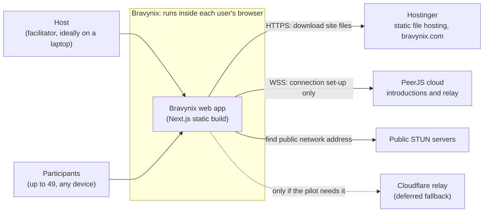

| Actor or system | Role | What it sees | Status |
| --- | --- | --- | --- |
| Host | Creates the room, adds stories, controls rounds and the timer, votes | Everything in their own room, but no vote before it is revealed | Confirmed |
| Participant | Joins by link, votes, views results and history | Their own room copy; others' votes only after reveal | Confirmed |
| Hostinger | Serves the static site over HTTPS | Visitor IP addresses and page paths in access logs (the room ID is in the path; the host key after `#` is never sent) | Confirmed |
| PeerJS cloud | Introduces browsers and relays traffic for blocked networks | Peer IDs, IP addresses and connection set-up data; relayed traffic stays encrypted | Confirmed |
| Public STUN servers | Tell a browser its public network address | IP addresses only | Confirmed |
| Cloudflare relay | Fallback relay if the pilot shows PeerJS's relay isn't enough | Connection details only, never content | Deferred |

## 8. High-level architecture

Every browser runs the same app bundle. Its role decides which modules are active: the host's browser runs the room referee, and every browser (the host's included) runs a participant client.

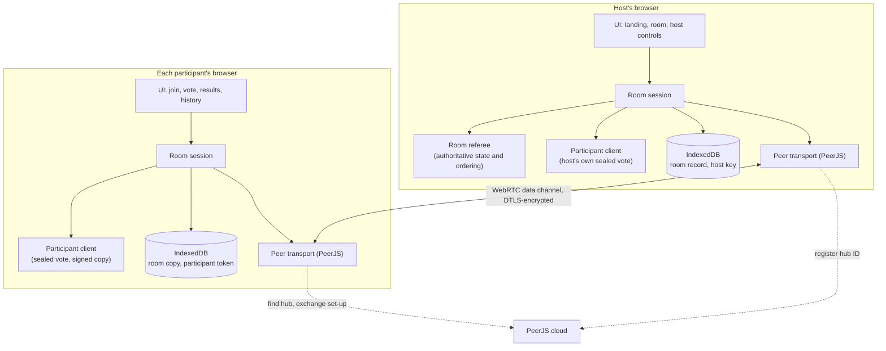

**Reading the diagram**

- Participants connect only to the host. They never connect to each other, so each holds one connection while the host holds up to 49.
- PeerJS cloud is used only to set up a connection, or to relay it when a direct path fails. Once the data channel is open, messages flow browser to browser.
- The host's own vote goes through the same sealed-vote path as everyone else's, inside the host's browser. So the referee code never handles an unopened vote value, not even the host's.

**Logical versus physical arrangement**

- **Logically** there are two roles, referee and participant, plus shared modules.
- **Physically** there is one deployable artifact: a folder of static files on Hostinger. There is no backend runtime, no database server and no background worker.
- The "server" for a room is the host's browser tab, for as long as it stays open.

## 9. Component and module responsibilities

The app is split into ten modules with one-way dependencies. The rules that matter most (voting, privacy, calculation) live in pure TypeScript modules that never touch the UI, the network or storage, so they can be unit-tested in isolation.

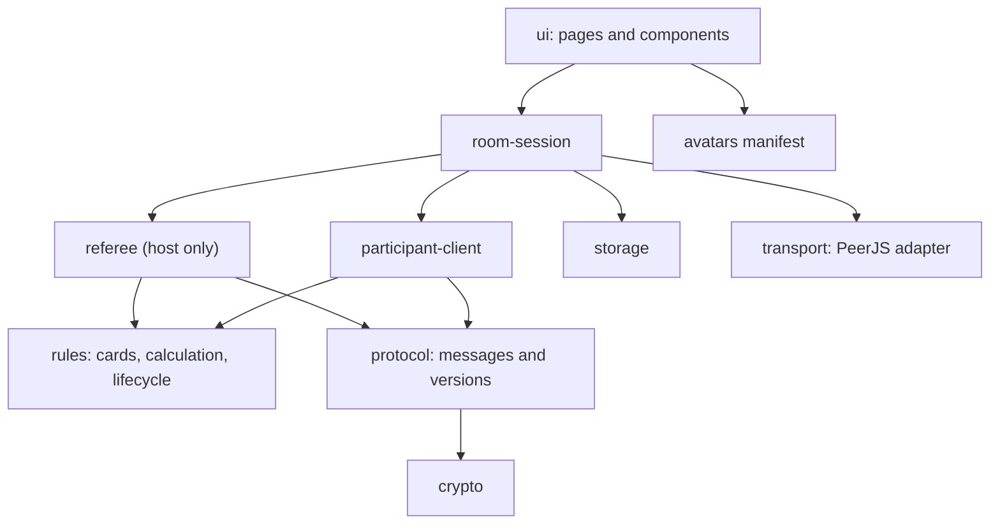

| Module | Responsibilities | Data it owns | Runs in | Failure behaviour |
| --- | --- | --- | --- | --- |
| `ui` | Pages: `/` landing, `/r/<roomId>` room, `/privacy`. Card deck, roster, results, history, timer, host controls, diagnostics panel, screen-reader announcements | None; renders what `room-session` gives it | Every browser | Shows connection state; never enables an action the referee would refuse |
| `room-session` | Decides the role; starts the referee and participant client; keeps one active tab per room; reconnects; fires the 24-hour expiry | Session wiring only | Every browser | Retries connections with back-off; shows "Reconnecting" |
| `referee` | The room's state machine: stories, rounds, roster, the cap of 50, sealed-vote collection, reveal, results, timer, end. Orders every change with a sequence number, removes duplicates, rate-limits each participant and signs each new state version | Authoritative room state | Host's browser | Refuses invalid or late messages with a reason; state saved after every change |
| `participant-client` | Makes sealed votes, keeps the card and salt until reveal, sends openings, applies events in order, asks for a snapshot on a gap, verifies host signatures | Its replica of the room; its own card and salt | Every browser | Rejects unsigned or mis-signed data; falls back to the last good snapshot |
| `rules` | Card deck, calculation, validation limits, lifecycle transitions | Constants and pure functions | Every browser | None (pure code) |
| `protocol` | Message types, schema validation, protocol version, size limits, message IDs | Message definitions | Every browser | Drops malformed messages; asks an outdated client to refresh |
| `crypto` | Key generation, room-ID derivation, signing and verifying, vote fingerprints, secure random IDs and salts, host-link encoding | Nothing stored | Every browser | Refuses to proceed if Web Crypto is unavailable |
| `storage` | IndexedDB access, the "My rooms" index, purging expired rooms on every load | Browser-stored rooms, keys, tokens | Every browser | Falls back to memory only if IndexedDB is unavailable, and says so |
| `transport` | PeerJS adapter: register the hub ID, connect, reconnect, split large messages, network-path settings, connection diagnostics | Live connections | Every browser | Surfaces "can't reach PeerJS cloud" and "can't reach host" as distinct errors |
| `avatars` | Manifest of about 20 avatar IDs mapped to bundled SVG files | Avatar list | Every browser | Unknown avatar ID shows no avatar |

**Dependency rules**

1. `referee`, `participant-client`, `rules`, `protocol` and `crypto` never import UI code, PeerJS or browser-storage APIs. This keeps them testable and lets the referee move server-side later (ADR-09).
2. Only `transport` imports PeerJS. Only `storage` touches IndexedDB or localStorage.
3. `ui` talks only to `room-session` and the avatar manifest.

**Rules shared by every module**

These are defined once in `rules` and never duplicated:

- the card set from FR-011;
- the calculation from PRD 11;
- the protocol version;
- the avatar ID list;
- the limits: 50 people, 500 stories, 160-character titles.

## 10. Data architecture

All room data lives in browsers. The host's browser writes the only authoritative record; every participant keeps a host-signed copy. Each device deletes its copy 24 hours after the room was created.

**Conceptual entities**

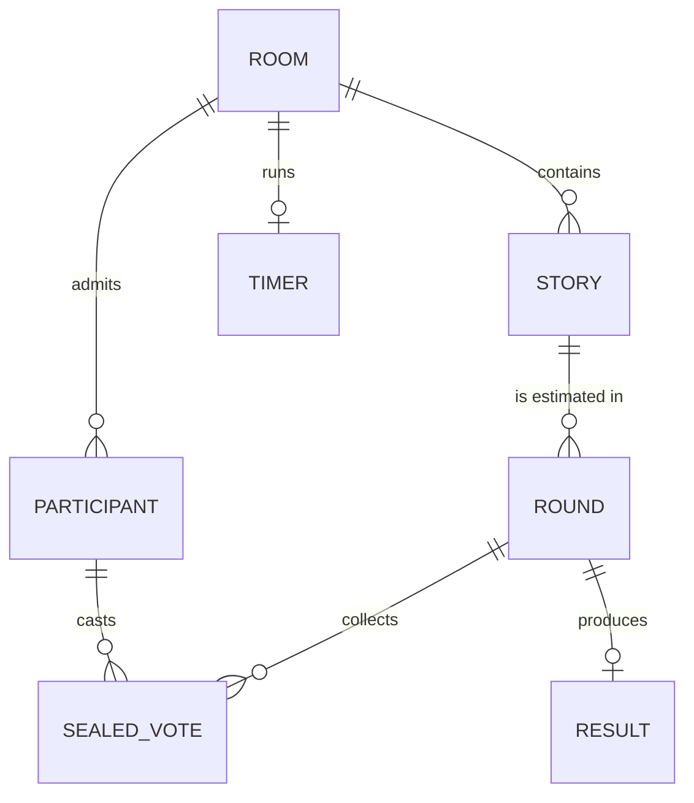

| Entity | Main fields (conceptual) | Written by | Copies held by |
| --- | --- | --- | --- |
| Room | Room ID, Epic title, created at, expires at (created + 24 h), status, host public key, state version, signature | Referee | Host and every participant |
| Story | Story ID, title (1 to 160 characters), position, status | Referee | Everyone |
| Round | Round ID, story, round number, status, started and revealed times | Referee | Everyone |
| Sealed vote | Fingerprint before reveal; card, salt and name and avatar snapshot after reveal | The voter creates it; the referee records it | Fingerprint: host only. Card and salt: the voter only, until reveal. Everyone after reveal |
| Result | Sum in half-points, numeric count, `?` count, not voted, not revealed, display average | Referee | Everyone |
| Participant | Participant ID, token fingerprint, display name, avatar ID, joined at, online | Referee (roster); the participant holds its own token | Roster: everyone. Token fingerprint: host only |
| Timer | Duration, end time, running or stopped | Referee | Everyone |

**Lifecycles**

Room states:

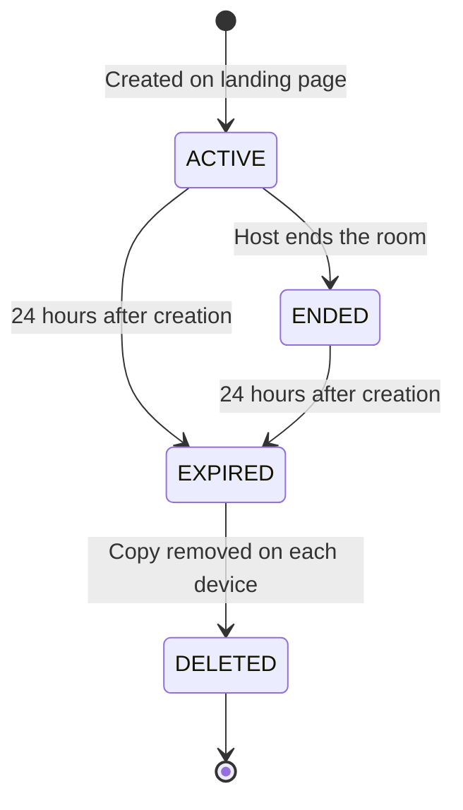

Round states. REVEALING and CANCELLED are new compared with PRD 12.2 (see section 23):

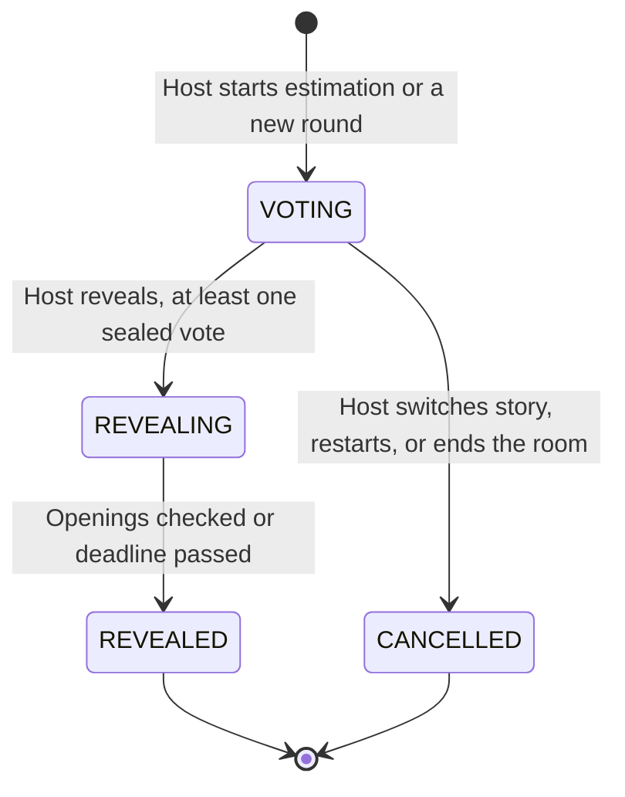

Story states. These close audit finding H-01; the cancel-or-block rule for a story switch during voting is still the owner's call:

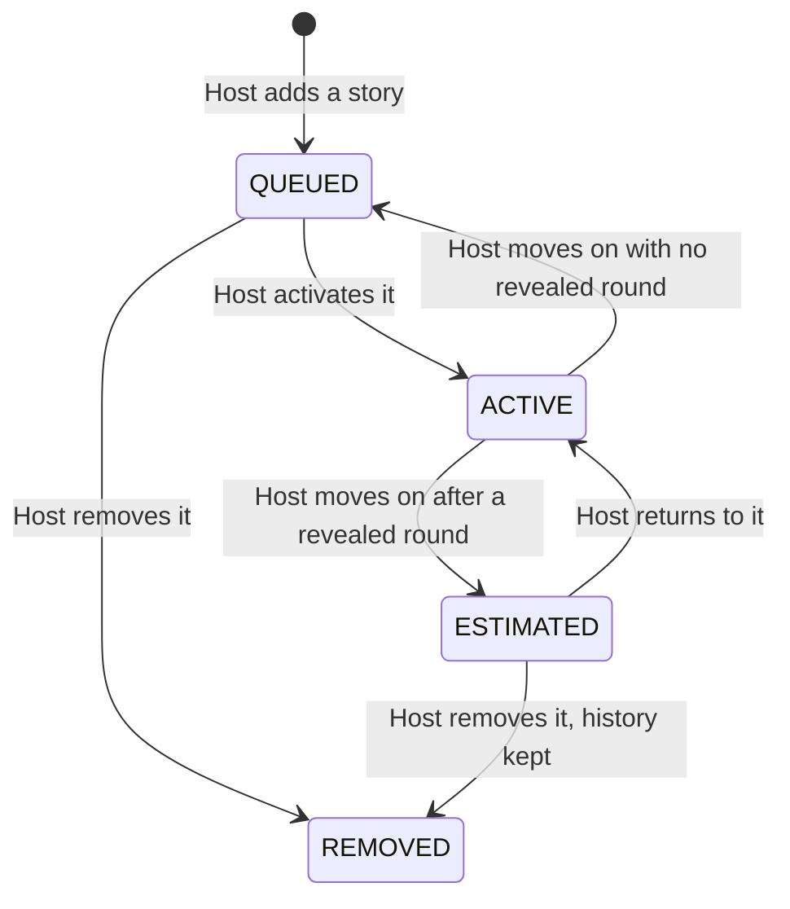

**Where each kind of data is stored on a device**

| Store | Contents | Present on | Deleted when |
| --- | --- | --- | --- |
| IndexedDB `rooms` | Room record (host) or signed copy (participant) | All devices that joined | Room's expiry time |
| IndexedDB `keys` | Host private key | Host devices only | Room's expiry time |
| IndexedDB `identity` | Participant ID and token for each room | All devices that joined | Room's expiry time |
| IndexedDB `votes` | Own card and salt for the open round | The voter's device | At reveal, or the room's expiry time |
| localStorage `myRooms` | Room ID, Epic title, role and expiry, for the landing page's "My rooms" list | All devices that joined | Room's expiry time |
| localStorage `prefs` (proposed) | Last-used name and avatar | Devices whose user opts in | Until the user clears it |

**Consistency rules**

- **Single writer.** Only the referee changes room state. Each change raises the state version and carries a sequence number.
- **Saved before acknowledged.** The host saves each change to IndexedDB before acknowledging it, which meets PRD 17's "persist before acknowledgement" on the device that holds the authoritative record.
- **Ordered copies.** Participants apply events in sequence order. A missing number triggers a request for a fresh signed snapshot.
- **No duplicates.** Every participant message carries a message ID, and the referee ignores repeats (PRD 12.3).
- **No floating-point errors.** Every card value is a multiple of ½, so sums are kept as whole half-points and the average is computed only for display. This is the decimal arithmetic PRD 11.3 asks for. Display rounding: at most two decimals, half-up (proposed; audit M-02).
- **Isolation between rooms.** Browser storage is scoped to bravynix.com and keyed by room ID. The referee rejects any story, round or participant ID that doesn't belong to its room.

**What the design deliberately leaves out**

- No server database, cache, object storage, backups or exports. The PRD excludes exports in 7.2.
- Avatars are bundled image files referenced by ID; there are no uploads.
- Copies of a browser profile made by operating-system backup tools are outside Bravynix's control. The privacy notice should say so.

## 11. Key data flows and sequence diagrams

Five flows carry the product: create, join, vote and reveal, expiry, and host recovery. Every other host action (add or reorder a story, start a round, start the timer, end the room) follows one pattern: the host sends a command, the referee validates it, then saves, signs and broadcasts the change.

### 11.1 Where data moves

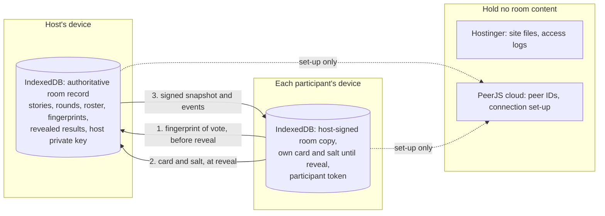

### 11.2 Create a room

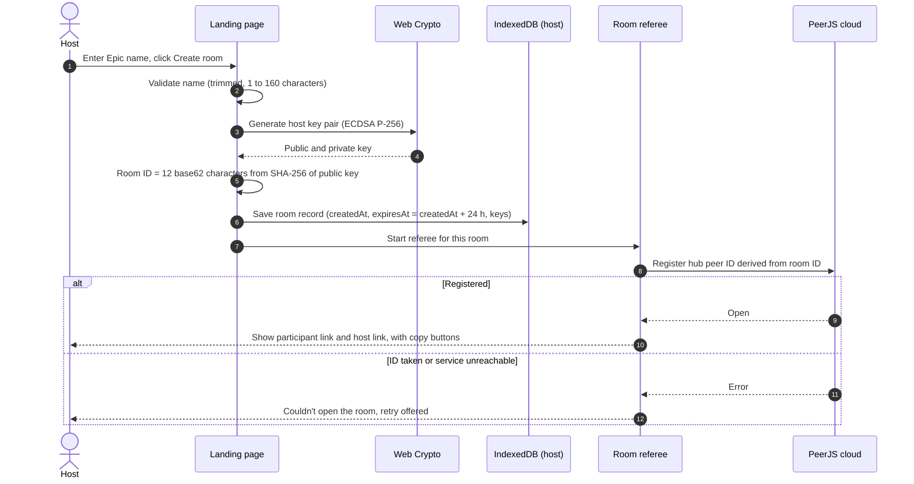

- **Checks:** Epic name rules (FR-001, PRD 13.2). No server involvement, so nothing can be refused remotely.
- **Failure:** if PeerJS cloud can't be reached, the room record stays saved and the host can retry. A fresh key always produces an unused ID, so "ID taken" means something is wrong and is shown as an error.
- **Host link:** the creation screen shows the host link once, with a warning that anyone holding it controls the room.

### 11.3 Join and verify the host

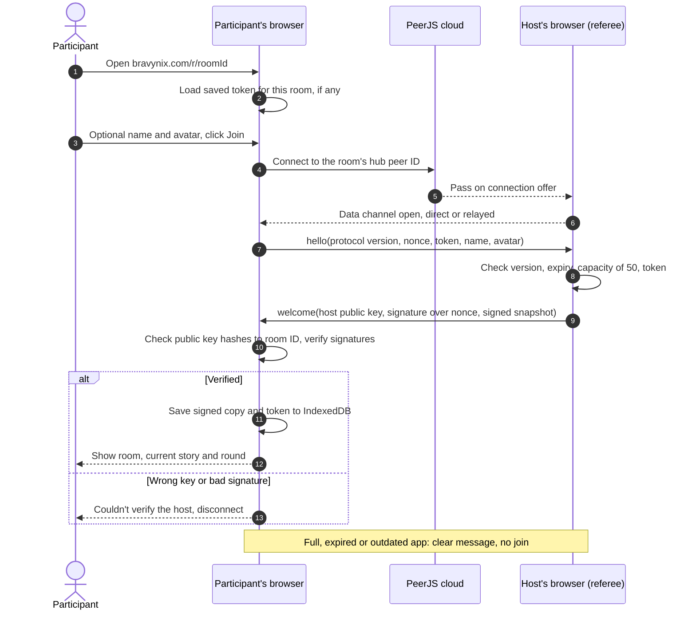

- **Who checks what:** the participant verifies the host by checking that the host's public key hashes to the room ID in the link. The referee recognises a returning participant by their token (FR-006).
- **Host offline:** the hub ID isn't registered, so the participant sees "Waiting for the host to open the room", and the app retries automatically.
- **Joining after reveal:** the participant receives the revealed result in the snapshot and can vote from the next round (FR-031).

### 11.4 Vote and reveal with sealed votes

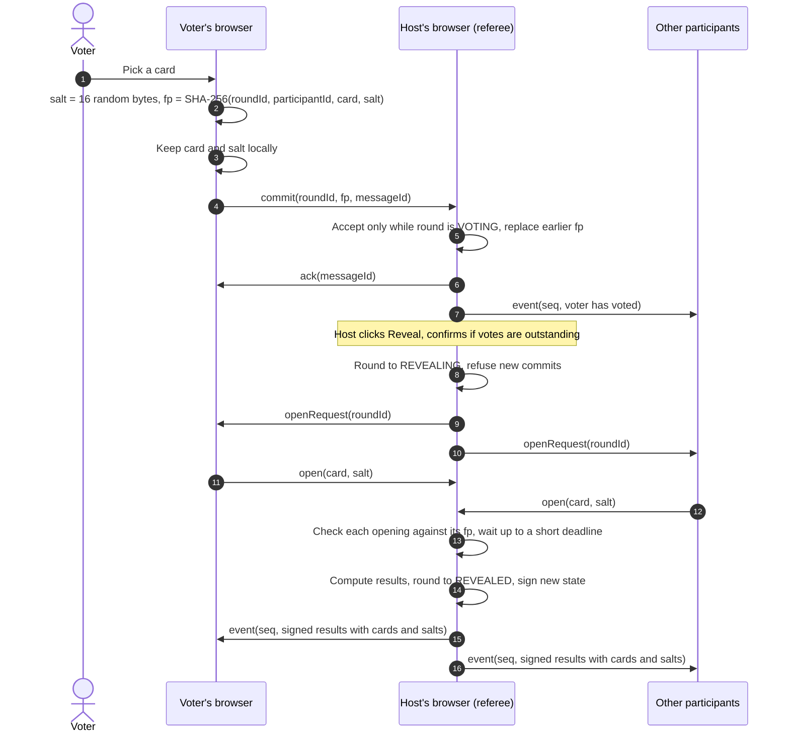

- **Privacy:** before reveal the referee holds only fingerprints, which can't be reversed because each includes 16 random bytes. FR-013 and PRD 14.2 therefore hold even against the host.
- **Race with a late vote:** commits arriving after the round moves to REVEALING are refused with "Round closed". This gives PRD 18.5.4 one final order.
- **Voter offline at reveal:** a voter who returns before the deadline can still open, because their card and salt are saved on their device. After the deadline their vote shows as "not revealed" and is left out of the average.
- **Deadline:** a few seconds, tuned in the pilot (proposed).
- **Bad opening:** an opening that doesn't match its fingerprint is shown as invalid and excluded. Everyone can re-check every result because the salts are published.
- **Calculation:** follows PRD 11. Results show the average, numeric count, `?` count, not voted and not revealed.

### 11.5 Expiry and purge

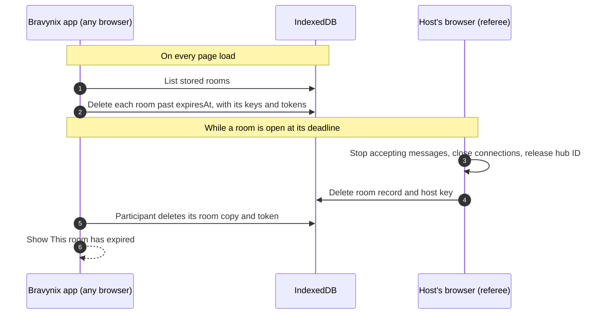

- **Rooms are independent.** Each room has its own expiry time, so five rooms created at different times disappear one by one.
- **Limit:** a device that never opens bravynix.com again keeps its expired copy until it does. It is never sent anywhere.
- **Clocks:** expiry uses the creation time signed by the host, checked against each device's own clock. A device with a badly wrong clock deletes early or late.

### 11.6 Host recovery with the host link

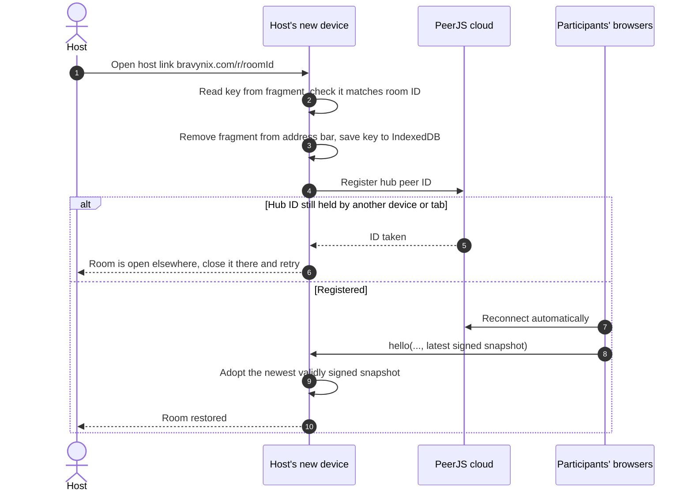

- **One host device at a time.** A room has one hub ID, so only one device or tab can act as host at once. This replaces the earlier assumption that two host devices could be active together (ADR-11).
- **Restoring state.** The new device rebuilds the room from participants' signed copies. If no participant is online, it starts from what it can verify, which may be an empty room.

## 12. Communication boundaries and message protocol

There is no HTTP API. All room traffic is messages on WebRTC data channels between each participant and the host. Everything inside one browser is plain function calls.

| From → to | Channel | Style | Carries | Trust |
| --- | --- | --- | --- | --- |
| Browser → Hostinger | HTTPS | Request and response | Static site files only | Trusted to serve unaltered code (see R-06) |
| Browser ↔ PeerJS cloud | Secure WebSocket on port 443 | Asynchronous | Hub registration, connection offers, network candidates | Untrusted: passes on set-up data only |
| Participant ↔ host | WebRTC data channel, reliable and ordered, DTLS-encrypted | Asynchronous messages | All room traffic | Host proven by key; participant known by connection and token |
| Modules within a browser | Function calls through typed interfaces | Synchronous | In-memory objects | Same trust boundary |

**Message families** (high level; the exact format belongs in the build)

| Family | Direction | Purpose |
| --- | --- | --- |
| `hello` and `welcome` | Participant → host, then back | Handshake: protocol version, nonce, token, host proof, signed snapshot |
| `command` | Host's UI → referee (local, never over the network) | Host-only actions: stories, rounds, reveal, timer, end |
| `commit` and `open` | Participant → host | Sealed vote, then its opening at reveal |
| `event` | Host → all | One ordered, signed state change |
| `snapshot` | Host → one participant | Full signed state, split into chunks when large |
| `ack` and `reject` | Host → sender | Outcome, with a reason code |
| `ping` | Both ways | Presence only; never counts as activity |

**Protocol rules**

1. **Versioned.** Every `hello` carries the protocol version. A mismatched client gets "A newer version of Bravynix is available, please refresh" instead of undefined behaviour after a deploy.
2. **Validated.** Every message is checked against its schema and a size limit (16 KB, proposed), and unknown types are dropped. Card values must come from the FR-011 set, avatar IDs from the manifest, and titles must be 1 to 160 characters.
3. **Host-only by construction.** Host commands start inside the host's browser. Any message from a participant connection that claims a host action is rejected.
4. **Idempotent.** Each message carries a sender message ID, and the referee ignores repeats. After reconnecting, a client resends unacknowledged messages with the same IDs.
5. **Ordered.** Events carry sequence numbers. A gap causes a snapshot request, never a guess.
6. **Answered.** Commits and joins get `ack` or `reject` with a reason: `round-closed`, `not-host`, `invalid-card`, `rate-limited`, `room-full`, `room-expired` or `version-mismatch`.
7. **Rate-limited.** The referee caps each participant's message rate (10 per second, proposed) and closes connections that keep exceeding it.
8. **Timeouts and retries.** Reconnects back off from 1 second up to 30 seconds (proposed). The reveal deadline closes REVEALING even if some voters never answer.

## 13. Security and privacy architecture

Access works as follows:

- **Joining** means knowing the link.
- **Host power** means holding the host key.
- **Vote privacy** comes from sealed votes.

The largest remaining risk is malicious script in the page: injected through user input, or served from a compromised website. That would expose the host key and the votes of anyone using the page. So the content security policy and account protection are launch requirements, not polish.

### 13.1 Access model

| Control | Mechanism | PRD |
| --- | --- | --- |
| Unguessable room link | Room ID = 12 base62 characters (about 71 bits) taken from the SHA-256 hash of the host's public key. No list of rooms exists anywhere | FR-002, 14.1 |
| Host authority | ECDSA P-256 key pair made in the host's browser. Participants check the key hashes to the room ID, that the host signed their random nonce, and the signature on every state version | FR-003, 14.1 |
| Host link | `bravynix.com/r/<roomId>#h=<key>`. The part after `#` is never sent in requests or referrer headers. The app removes it from the address bar after reading it, and the creation screen warns that the link grants control | A-07, FR-033 |
| Participant identity | Random participant ID plus a 32-byte token per room, saved in the browser. The host keeps only the token's fingerprint. Not a verified person | FR-006, A-08 |
| Host-only actions | Issued only inside the host's browser. Participant connections can send only `hello`, `commit`, `open` and `ping` | 14.1, 18.1.7 |
| Revocation | No per-participant removal (A-12). End room makes it read-only; expiry closes everything; a lost host key means lost control | A-12, 16 |

### 13.2 Vote privacy

- **Fingerprints only.** Before reveal the referee holds fingerprints only. Each one includes 16 random bytes of salt, so trying all ten cards can't recover it.
- **The host votes the same way.** The host's own vote goes through the same sealed path.
- **No early totals.** The average and distribution are computed only at reveal (PRD 14.2).
- **Votes can't be faked.** After reveal, every participant re-checks every opening against its fingerprint. Each voter's app also compares the published result with the card it actually sent, and warns if they differ. A host who fabricates a vote would therefore be caught.
- **Visible before reveal:** who has voted (allowed by FR-027).

### 13.3 Threats and mitigations

| ID | Threat | Mitigation | What remains |
| --- | --- | --- | --- |
| T-01 | Guessing a room link | 71-bit IDs; nothing lists rooms | None material |
| T-02 | Someone with the link takes the hub ID while the host is offline | Participants demand proof of the host key, so an impostor can't take part | They can block the room until the host returns (R-07) |
| T-03 | Interception during connection set-up (network attacker or PeerJS operator) | DTLS encryption; host key proof; votes sealed until reveal | A relay placed in the middle could read revealed data. Future hardening: bind the host's signature to the connection's DTLS fingerprints |
| T-04 | Host reads votes early in developer tools | Values are never sent before reveal | None |
| T-05 | Participant forges host commands | Host commands are local; participant message types are restricted | None |
| T-06 | Script injection through names or titles | React escaping, no raw HTML, length limits, strict content security policy, no third-party scripts | Depends on keeping the policy strict |
| T-07 | Compromised Hostinger or GitHub account, or a malicious dependency, serves bad code | Two-factor sign-in on both accounts, locked dependency versions, deploy only from the CI build, branch protection | Residual; high impact if it happens (R-06) |
| T-08 | Flooding the host with joins or messages | Cap of 50, per-participant rate and size limits, throttled join attempts | A determined attacker with the link can still disrupt one room |
| T-09 | Room links leaking through referrer headers or analytics | `Referrer-Policy: no-referrer`; no analytics; host key only after `#` | None |
| T-10 | Room data left on a shared computer | Purge on every load; a "Delete this room from this device" action (proposed) | Until expiry, anyone using that browser profile can see it |
| T-11 | Room ID visible in Hostinger access logs (it is in the path) | Logs are visible only to the owner and Hostinger; keep log retention short | Optional alternative: `bravynix.com/r#<roomId>` keeps it out of logs entirely (open question Q-05) |

### 13.4 Where each control lives

- **In the app:** input validation, output escaping, signatures, sealed votes, rate limits, purge of expired rooms, removing the host key from the address bar.
- **At Hostinger, through `.htaccess`:**
  - HTTPS with HSTS.
  - A content security policy that only allows its own scripts and connections to PeerJS cloud, with no `unsafe-eval`. Next.js inline-script needs are settled during the build.
  - `Referrer-Policy: no-referrer`, `X-Content-Type-Options: nosniff`, and `frame-ancestors 'none'`.
  - A Permissions-Policy that turns off camera and microphone.
- **Accounts:** two-factor sign-in on Hostinger and GitHub. V1 has no secrets at all; the deferred Cloudflare relay key would live only in its Worker.

### 13.5 Privacy

- **Collected:** Epic and story titles, optional names, avatar choice, votes and timestamps. Stored only on the devices in the room.
- **Network data held by others:**
  - Hostinger's access logs: IP address and page path.
  - PeerJS cloud: IP address and peer ID.
  - STUN servers: IP address.
- **New finding: peer-to-peer exposes IP addresses.** With direct connections the host's browser sees every participant's IP address, and participants see the host's. This is inherent to peer-to-peer and must be in the privacy notice.
- **Privacy notice:** use the agreed wording. Add the IP-address point, the access logs, and that a device keeps its expired copy until the site is next opened on it. Don't call the service anonymous (PRD 14.4).
- **No compliance claim** is made. A legal review of the notice before public launch is recommended (audit L-07).

## 14. Performance and scalability

The number of rooms running doesn't load any Bravynix server, because there isn't one. Each room's load sits on its host's device, and connection set-up load sits on PeerJS cloud. The real limits are therefore the host's device and that third-party service, not traffic.

**Inside one room** (estimates, to be confirmed by the 50-person load test)

- **The host carries the room.** The host holds up to 49 data channels and sends each change to all of them. Messages are small, mostly under 1 KB, so bandwidth is minor. The cost is keeping 49 live connections healthy on one device.
- **Two hops per update.** A vote reaches others via participant → host → everyone. Direct paths between Indian cities should be fast. A relayed path adds a round trip to wherever PeerJS's relay is hosted, which is unknown; the pilot measures it against the 500 ms target (AD-13).
- **Joining takes a few seconds.** Connection set-up needs a signaling exchange and a network-path search, so PRD 17's 2-second join target may be tight. It is measured in the pilot, not promised.
- **Large rooms make large snapshots.** A room with hundreds of stories, several rounds each and 50 voters could produce a multi-megabyte join snapshot. Mitigations, in order: split it into chunks, compress it with the browser's built-in compression, and load full vote details only when someone opens a round in History. Typical sessions of 20 to 50 stories stay small.

**Bottlenecks and single points of failure**

| Bottleneck | Effect | Mitigation |
| --- | --- | --- |
| Host's device or tab | Voting pauses if it sleeps, loses network or closes. Phones suspend background tabs, and laptops may slow timers in hidden tabs | Recommend a laptop for rooms of more than about 15. Keep the screen awake during a meeting (Screen Wake Lock, proposed). Warn the host when the tab is hidden. Load-test with the tab in the background |
| PeerJS cloud | No new joins or reconnects while it is down; open connections continue | Clear error message. Self-hosted signaling or the server-room fallback if reliability or terms become a problem |
| Relay capacity | Users on blocked networks can't join if the relay is overloaded | Cloudflare relay fallback (ADR-04) |
| Hostinger | The site can't load; rooms already open keep working | Static files cache well; a CDN is optional later |

**What changes as Bravynix grows**

| Stage | The design as it stands | What would need to change |
| --- | --- | --- |
| Pilot and early beta (tens of rooms a day) | Works as designed | Nothing |
| Hundreds of rooms a day | Unchanged for Bravynix | Watch PeerJS cloud errors and terms. Self-host signaling if needed, which needs a small server |
| Rooms above 50, or hosts on unreliable devices | Outside the design | Move the referee to a server-side room (ADR-09) |

The design makes no claim of unlimited scale. Its stated limit is 50 people per room, held on one host device.

## 15. Reliability and recovery

The host saves every change before acknowledging it, so short failures (a refresh, a network blip) lose nothing and recover on their own. Long failures of the host's device pause the room, and only the host link brings it back.

| Failure | What people see | Effect on data | Recovery |
| --- | --- | --- | --- |
| Host refreshes the page | Brief "Reconnecting" | None: the referee reloads from IndexedDB | Automatic: hub re-registered, participants reconnect |
| Host's network drops briefly | "Reconnecting" for everyone | None | Automatic, with back-off |
| Host closes the tab or the laptop sleeps | "Waiting for the host". History stays readable from each person's own copy | The open round stays open; voters keep their sealed votes | The host reopens the room in the same browser or with the host link |
| Host's device is lost or broken | As above | If the host link is also lost, host control is gone; participants keep read-only copies until expiry | Host link on another device rebuilds from participants' signed copies (11.6) |
| A participant drops | Shown as offline | Their fingerprint stays. If they're back before the reveal deadline their vote opens; otherwise "not revealed" | Automatic reconnect with the same token |
| PeerJS cloud is down | New joins and reconnects fail with "Can't reach the connection service" | None; open connections carry on | Automatic retry; self-hosted signaling or the server-room fallback if this recurs |
| A network blocks direct and relayed paths | "Can't connect to the host from this network", plus diagnostics | None | Try another network such as a phone hotspot; Cloudflare relay fallback |
| Hostinger is down | The site won't load | None; open rooms keep working | Wait; nothing to restore |
| Browser storage is cleared | The participant rejoins as someone new (A-08). A host without the host link loses the room | That device's copy is gone | Accepted no-login limit |
| App updated during a meeting | Newly loaded clients show "Please refresh" if the protocol changed | None | Deploy outside Indian working hours; keep minor versions compatible |
| Room opened in two of the host's tabs | Second tab: "This room is open in another tab" | None | One-tab lock in the browser (Web Locks API) |
| A device's clock is wrong | Expiry happens early or late on that device | Timing only | Timer shown as time remaining from the host, not by local clock |
| A participant sends forged or altered state | Rejected silently | None | Signature check |

**Recovery targets** (proposed for discussion, not commitments)

- **Data loss (RPO):** zero for any change the host has acknowledged. Clients resend unacknowledged messages after reconnecting.
- **Recovery time (RTO) after a refresh or network blip:** within 30 seconds (proposed; measured in the pilot).
- **Recovery time after losing the host's device:** as soon as the host opens the host link, provided participants are online to supply the signed state.
- **Backups:** none by design. No server copy exists to restore.

## 16. Deployment architecture

One zip of static files is the entire deployment. Everything else is either the users' browsers or a third-party managed service.

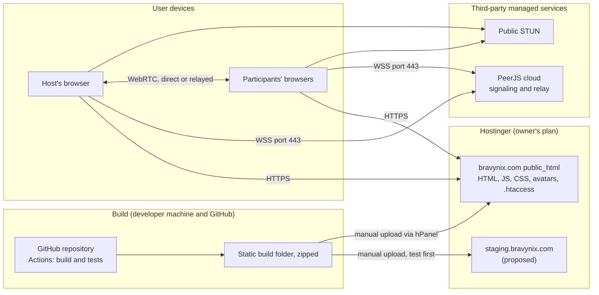

**Environments**

| Environment | Where | Connection service | Purpose |
| --- | --- | --- | --- |
| Local | Developer's machine with `next dev` | Local open-source PeerServer | Fast, repeatable tests that don't depend on PeerJS cloud |
| Staging (proposed) | `staging.bravynix.com` on Hostinger | PeerJS cloud with peer-ID prefix `bvx-stg-` | Pilot, smoke tests and release checks. The separate prefix stops staging and production rooms from ever colliding |
| Production | `bravynix.com` on Hostinger | PeerJS cloud with peer-ID prefix `bvx-` | Public site |

**Build and release**

1. A change merged to `main` triggers GitHub Actions: type-check, unit tests, multi-browser tests against a local PeerServer, then a Next.js static export zipped as a build artifact.
2. Upload the artifact to staging through hPanel. Smoke-test it: create a room on a laptop, join from a phone on mobile data, vote, reveal.
3. Upload the same zip to production. Keep the previous zip for rollback.
4. Release outside Indian working hours (after 21:00 IST, proposed), because open meetings keep running the old code until they refresh.

**Rollback.** Re-upload the previous zip. The protocol-version check tells mismatched clients to refresh.

**`.htaccess` responsibilities**

- Redirect to HTTPS and set HSTS.
- Send the security headers from 13.4.
- Rewrite `/r/*` to the room page; the page reads the room ID from the path.
- Cache fingerprinted JS and CSS for a long time, but never cache HTML, so a refresh always gets the current version.
- Serve the neutral "not found" page.

**Configuration.** V1 has no secrets. Public settings are fixed at build time, so each environment gets its own build: PeerJS host, peer-ID prefix, STUN list and protocol version.

**Health check.** There is no server to probe. A scheduled smoke test on GitHub Actions (daily, proposed) creates a production room and joins it from two headless browsers. It gives early warning if PeerJS cloud changes or breaks; its cost depends on the GitHub plan.

**Logical versus deployed.** The referee is logically the room's server, but it ships inside the static bundle and runs only while the host's tab is open. No component is deployed separately.

## 17. Observability

V1 deliberately collects no telemetry, so you will see production problems only through user reports and a daily smoke test. That is the price of the privacy promise; section 21 says when to revisit it.

| Area | V1 approach |
| --- | --- |
| Logging | No room activity is logged anywhere off the device. Hostinger keeps its normal access logs. Browser console messages never include vote values, salts or keys |
| Diagnostics | An in-app panel shows: connection state, direct or relayed path, whether PeerJS cloud is reachable, protocol version and the last error code. "Copy diagnostics" produces text with no room content or keys, for users to send to support |
| Metrics | None in production. Latency, join time and the mix of direct and relayed paths are measured in pilot and test builds only |
| Alerting | The scheduled smoke test (section 16) emails the owner through GitHub when it fails |
| Auditing | Each room's own signed event history records who did what and when, for the room's 24-hour life. There is no server-side audit trail |

## 18. Integration architecture

Bravynix integrates with four outside services, all at the network level, and never sends them room content. PeerJS cloud is the one that matters: if it fails, new rooms can't form.

| Service | Purpose | Interface | Data it sees | Known limits | If it fails | Exit plan |
| --- | --- | --- | --- | --- | --- | --- |
| [PeerJS cloud](https://www.peerjs.com/docs) (signaling) | Introduce the host and participants | Secure WebSocket, port 443 | Peer IDs, connection offers, network candidates, IP addresses | Holds a connection offer for up to 5 seconds before rejecting it; networks that block port 443 can't reach it; terms and capacity for public use unverified (AD-20) | No new joins or reconnects; open rooms continue | Self-host the open-source PeerServer (needs a small server), or move to server rooms (ADR-09) |
| PeerJS relay (TURN) | Carry traffic when no direct path exists | Standard TURN, configured in PeerJS | Encrypted traffic and IP addresses | PeerJS's docs say the cloud provides a free TURN server; capacity, location and availability unverified | Users on blocked networks can't connect | Cloudflare relay (next row) |
| [Cloudflare relay](https://developers.cloudflare.com/realtime/turn/faq/index.md) (deferred) | Fallback relay | Standard TURN, with short-lived credentials from a tiny Worker | Connection metadata only; content stays encrypted | $0.05 per GB after the first 1,000 GB each month | Same as above | Not needed unless the pilot shows it |
| Cloudflare STUN (`stun.cloudflare.com`) | Tell each browser its public address | Standard STUN | IP addresses | Free and unlimited | Falls back to relayed paths | Any public STUN server |
| [Hostinger](https://www.hostinger.com/support/?p=13765) | Serve the static site | HTTPS | Page requests, IP addresses | Web and Cloud plans don't accept incoming WebSocket connections, which is why live rooms can't run there | Site can't load; open rooms continue | Any static host, such as Cloudflare Pages |
| Jira | — | — | — | Deferred by the PRD | — | Not applicable in V1 |

## 19. Architecture decision records

Twelve decisions shape V1: seven were accepted by the product owner on 16 October 2026, and five are proposed by this design and await approval.

| ADR | Decision | Status |
| --- | --- | --- |
| ADR-01 | Client-only peer-to-peer; no backend | Accepted |
| ADR-02 | Hub layout with the host's browser as referee | Accepted |
| ADR-03 | PeerJS, with PeerJS cloud for signaling | Accepted |
| ADR-04 | PeerJS relay now; Cloudflare relay only if the pilot needs it | Accepted |
| ADR-05 | Sealed votes (commit, then open at reveal) | Accepted |
| ADR-06 | Room ID derived from the host's public key; private key carried in the host link | Proposed |
| ADR-07 | IndexedDB per device; each room cleared 24 hours after creation | Accepted |
| ADR-08 | Next.js static export on Hostinger, with a rewrite for room links | Accepted |
| ADR-09 | Referee kept independent of transport, as the exit path to server rooms | Proposed |
| ADR-10 | No telemetry in V1; diagnostics panel and smoke test | Proposed |
| ADR-11 | One active host device or tab at a time | Proposed |
| ADR-12 | Versioned message protocol with a refresh prompt | Proposed |

### ADR-01: Client-only peer-to-peer, no backend

| Field | Record |
| --- | --- |
| Status | Accepted (product owner, 16 Oct 2026) |
| Context | The owner wants ₹0 running cost, no room data on servers, and deployment by zip upload to Hostinger, which can't host live connections |
| Options considered | Cloudflare Durable Objects; Supabase; Firebase; Hostinger VPS; peer-to-peer |
| Selected | Peer-to-peer: each room runs in participants' browsers |
| Rationale | The only option with no server-held room data and no server to operate or pay for |
| Trade-offs | Gains privacy and zero cost. Loses resilience when the host is away, guaranteed connectivity and an availability target |
| Consequences | Security and correctness move into browser code. Testing on real networks becomes a launch gate |
| Revisit when | The pilot shows frequent connection failures, or stalled rooms when the host leaves become a top complaint |

### ADR-02: Hub layout with the host's browser as referee

| Field | Record |
| --- | --- |
| Status | Accepted |
| Context | 50-person rooms; one authority must order events; a full mesh needs 49 connections per browser |
| Options considered | Full mesh (Trystero); hub at the host; hub at an elected participant |
| Selected | Hub at the host |
| Rationale | The host is already the authority for reveal and stories. Participants need one connection each |
| Trade-offs | Simple ordering, but all load and availability rest on the host's device |
| Consequences | Hosts are advised to use a laptop for rooms above about 15; a 50-person load test is required |
| Revisit when | The load test fails at 50, or hosts commonly use phones |

### ADR-03: PeerJS, with PeerJS cloud for signaling

| Field | Record |
| --- | --- |
| Status | Accepted (product owner, 16 Oct 2026) |
| Context | The hub layout needs connections to a specific peer; no server of our own |
| Options considered | PeerJS; Trystero over public networks; simple-peer with our own signaling |
| Selected | PeerJS, using the free cloud service |
| Rationale | Connect-by-ID fits the hub. Nothing to run. The open-source server allows self-hosting later |
| Trade-offs | Free and simple, but a third-party dependency with no guarantee and unverified terms |
| Consequences | Terms must be checked before launch (AD-20); errors from the service need clear messages |
| Revisit when | Terms disallow public production use, or reliability problems appear in the smoke test |

### ADR-04: Relay strategy

| Field | Record |
| --- | --- |
| Status | Accepted (product owner chose option a, 16 Oct 2026) |
| Context | Some office, VPN and mobile networks block direct connections |
| Options considered | (a) PeerJS relay, Cloudflare later if needed; (b) Cloudflare relay from day one; (c) no relay |
| Selected | (a) |
| Rationale | Keeps V1 server-free while keeping a costed fallback ready |
| Trade-offs | No new component, but relay quality is unknown until the pilot |
| Consequences | The pilot must include blocked-network cases. Falling back means a small credential Worker on Cloudflare |
| Revisit when | The pilot finds users who can't connect, or relayed latency misses the 500 ms target |

### ADR-05: Sealed votes

| Field | Record |
| --- | --- |
| Status | Accepted |
| Context | Every message passes through the host's browser, yet votes must stay hidden even from the host (FR-013) |
| Options considered | Send values to the host; encrypt to a key the host doesn't hold (impossible without a third party); commit and open |
| Selected | Commit a salted SHA-256 fingerprint; open at reveal |
| Rationale | Standard technique; no extra infrastructure; anyone can verify results |
| Trade-offs | Strong privacy, but a voter offline at reveal can't be opened |
| Consequences | Adds the REVEALING round state and a reveal deadline. PRD needs a "not revealed" result category |
| Revisit when | Moving to server rooms, where the server can hold values privately |

### ADR-06: Host identity bound to the room ID

| Field | Record |
| --- | --- |
| Status | Proposed |
| Context | Anyone with the link knows the hub's peer ID and could pretend to be the host; the owner wants a unique host link |
| Options considered | A separate host token checked by participants (but they would need to know it); a host public key in the participant link (long links); room ID derived from the host key |
| Selected | Room ID = 12 base62 characters from the SHA-256 hash of the host's public key. The host proves ownership by signing each participant's nonce. The private key travels only after `#` in the host link |
| Rationale | Short participant links that still let every participant verify the host without any server |
| Trade-offs | Unforgeable host identity, but a long host link (about 130 characters) and no way to rotate the key |
| Consequences | Losing the host link and the original browser means losing host control (accepted, PRD A-07) |
| Revisit when | Host transfer or co-hosts are added |

### ADR-07: Browser storage and 24-hour clearing

| Field | Record |
| --- | --- |
| Status | Accepted (product owner, 16 Oct 2026) |
| Context | No server storage; each room's data must be cleared 24 hours after it was created, independently of other rooms |
| Options considered | IndexedDB; localStorage only; memory only |
| Selected | IndexedDB for room data, with localStorage for a small "My rooms" index. Expiry = creation time + 24 hours, signed by the host; purge on every load and at the deadline |
| Rationale | Survives refresh, holds structured data, and lets every device delete on its own |
| Trade-offs | Works offline, but a device that never revisits keeps an expired copy |
| Consequences | PRD lifecycle rules change (section 23). The privacy notice must explain on-device copies |
| Revisit when | The PRD reintroduces an inactivity rule or exports |

### ADR-08: Next.js static export on Hostinger

| Field | Record |
| --- | --- |
| Status | Accepted |
| Context | Owner prefers Next.js and zip upload to the existing Hostinger plan |
| Options considered | Next.js static export; Hostinger Node.js web app; Cloudflare Pages |
| Selected | Static export uploaded to `public_html`, with an `.htaccess` rewrite that serves `/r/*` from one room page |
| Rationale | Matches the owner's workflow. No running process, so nothing to sleep or crash |
| Trade-offs | No server features, which the design doesn't need |
| Consequences | Security headers are set in `.htaccess`; deploys are manual |
| Revisit when | Server rendering or APIs become necessary |

### ADR-09: Referee independent of transport

| Field | Record |
| --- | --- |
| Status | Proposed |
| Context | Peer-to-peer may prove unreliable on real networks; switching later should not mean a rewrite |
| Options considered | Referee coupled to PeerJS and the UI; referee as pure TypeScript behind interfaces |
| Selected | Pure TypeScript referee with no UI, PeerJS or storage imports |
| Rationale | The same code could run in a server-side room (for example a Cloudflare Durable Object) behind a different transport |
| Trade-offs | Cheap exit and easy testing, at the cost of a little interface plumbing now |
| Consequences | Enforced by the dependency rules in section 9 |
| Revisit when | Never on its own; it is a safety margin |

### ADR-10: No telemetry in V1

| Field | Record |
| --- | --- |
| Status | Proposed |
| Context | Privacy promise; no server to receive reports |
| Options considered | Third-party error reporting; self-built aggregate counters; none |
| Selected | None. An in-app diagnostics panel, plus a daily smoke test |
| Rationale | Keeps the privacy story simple and true |
| Trade-offs | Clean privacy, but production failures are invisible until reported |
| Consequences | The pilot carries the measurement load |
| Revisit when | Support reports show patterns the diagnostics panel can't explain |

### ADR-11: One active host device at a time

| Field | Record |
| --- | --- |
| Status | Proposed (supersedes the earlier assumption that two host devices could be active at once) |
| Context | A room has one hub peer ID on PeerJS cloud, and two referees would disagree about order |
| Options considered | Concurrent host devices with merging; single active host |
| Selected | Single active host. Another device or tab is told the room is open elsewhere |
| Rationale | Avoids split-brain ordering problems with no server to arbitrate |
| Trade-offs | Simple and safe, but the host can't control the room from laptop and phone together |
| Consequences | Host recovery works by closing the old device or tab, or by its absence |
| Revisit when | Co-host features are added |

### ADR-12: Versioned message protocol

| Field | Record |
| --- | --- |
| Status | Proposed |
| Context | A deploy can leave old and new app versions in one meeting |
| Options considered | No versioning; a version in the handshake with a refresh prompt |
| Selected | Protocol version in `hello`; mismatched clients prompted to refresh; minor versions kept compatible |
| Rationale | Turns silent breakage into a clear message |
| Trade-offs | Small cost, large clarity |
| Consequences | Release notes state whether the protocol changed |
| Revisit when | Never; standard practice |

## 20. Risk register

Three risks block a public launch until they are tested: blocked networks (R-01), PeerJS cloud's terms and reliability (R-02), and the host's device at 50 people (R-03).

Scale: probability and impact are each Low, Medium or High. "Blocks MVP" means the risk must be tested or resolved before public launch.

| ID | Risk | Probability | Impact | Affected | Mitigation | Remaining uncertainty | Blocks MVP |
| --- | --- | --- | --- | --- | --- | --- | --- |
| R-01 | Office, VPN or mobile networks block connections, so some people can't join | Medium | High | transport, PeerJS relay | Pilot on office Wi-Fi, a VPN, Jio and Airtel mobile data; diagnostics panel; Cloudflare relay ready (ADR-04) | Share of affected users unknown | Yes, pilot first |
| R-02 | PeerJS cloud's terms, capacity or uptime don't suit a public site | Medium | High | Signaling, relay | Read the terms before launch; daily smoke test; self-host or server-room exit (ADR-09) | No service guarantee exists | Yes, check terms |
| R-03 | The host's device can't hold 49 connections reliably | Medium | High | referee, transport | 50-person load test; laptop advice; Screen Wake Lock; lower the cap if needed | Varies by device and browser | Yes, load test |
| R-04 | Rooms stall when the host closes the laptop or the tab is suspended | High | Medium | referee | "Waiting for the host" state, hidden-tab warning, host link recovery | Accepted by the owner | No |
| R-05 | A voter leaves before reveal, so their vote can't be opened | Medium | Low | participant-client | Card and salt saved on the voter's device; reveal deadline; "not revealed" shown honestly | Accepted by the owner | No |
| R-06 | Malicious script steals the host key or reads votes (injection, or a compromised account or dependency) | Low | High | Whole app | Strict content security policy, escaping, two-factor sign-in, locked dependencies, deploy only from CI | Residual | No, but the controls are launch requirements |
| R-07 | Someone with the link takes the hub ID while the host is away, blocking the room | Low | Medium | transport | Host proof required, so they can't impersonate; the host can start a new room | Disruption possible | No |
| R-08 | Expired copies stay on devices that never revisit | High | Low | storage | Purge on load; privacy notice wording; "Delete from this device" action | Inherent to browser-only storage | No |
| R-09 | AI-generated code gets subtle protocol, crypto or ordering bugs | Medium | High | referee, participant-client, crypto | Pure, unit-tested modules; tests for vote leaks, forged messages and races; human review of the `crypto` and `referee` modules | Depends on review quality | No, but the tests are launch requirements |
| R-10 | Large rooms produce slow join snapshots | Low | Medium | protocol | Chunking, compression, loading History details on demand | Unmeasured | No |
| R-11 | Host IP addresses are visible to participants (and the reverse) | High | Low | transport | State it in the privacy notice; relay-only mode possible later | Inherent to peer-to-peer | No |
| R-12 | The app updates mid-meeting and versions mix | Medium | Low | protocol | Version check, evening releases, compatible minor versions | Low | No |

## 21. Future evolution

The design evolves in small, triggered steps rather than a planned rewrite. Its most useful property is that every room lives at most 24 hours, so any change to formats or protocol needs only a day's compatibility, never a long migration.

| Category | Item | Trigger |
| --- | --- | --- |
| Needed for the MVP | Everything in sections 6 to 18, plus the network pilot, the 50-person load test, the PeerJS terms check and the strict content security policy | Before public launch |
| Before a known threshold | Cloudflare relay plus a credential Worker | The pilot finds users who can't connect, or relayed latency misses 500 ms |
| Before a known threshold | Self-hosted signaling (PeerServer on a small server, or a Worker-based equivalent). Still no room data on a server | PeerJS cloud's terms forbid the use, or the smoke test shows repeated failures |
| Before a known threshold | Server-side rooms (for example Cloudflare Durable Objects) running the same referee (ADR-09) | Rooms over 50, stalled rooms as a top complaint, or hosts mostly on phones |
| Possible enhancement | Jira import and write-back. This needs server-held credentials, so it ends the no-backend model | Product decision to build integrations |
| Possible enhancement | Co-hosts or host transfer; observer role; custom card decks; export before deletion | PRD roadmap (section 20.1) |
| Possible enhancement | Bind the host's signature to the connection's DTLS fingerprints; shorter host links with Ed25519 keys | Security hardening pass |
| Possible enhancement | Privacy-preserving aggregate error counts | Support can't diagnose failures from user reports |
| Unnecessary now | Microservices, queues, caches, a database, a CDN, accounts | No requirement calls for them |

**Expensive to change later.** Publicly promising "no room data on our servers" is the hardest decision to walk back. Moving to server rooms would need a new privacy notice and clear communication to users. Everything else can change within one 24-hour cycle.

## 22. Requirements traceability matrix

All 34 P0 functional requirements have an architectural home. Five of them change meaning under peer-to-peer (FR-022 to FR-025 and FR-029); two non-functional targets (latency and capacity) must be validated rather than assumed, and the availability target is withdrawn.

| PRD item | Requirement (short) | Where it lives | Decision | Status |
| --- | --- | --- | --- | --- |
| FR-001 | Create room with Epic name | `ui` landing page, `rules` | ADR-08 | Supported |
| FR-002 | Unguessable link | `crypto` | ADR-06 | Supported |
| FR-003 | Separate host capability | `crypto`, `referee` | ADR-06 | Supported |
| FR-004 | Join without an account | `transport`, `participant-client` | ADR-01, ADR-03 | Supported |
| FR-005 | Optional name and avatar | `ui`, `avatars`, `rules` | — | Supported |
| FR-006 | Restore identity on refresh | `storage` (participant token) | ADR-07 | Supported |
| FR-007 | Host in roster and can vote | `referee`, host's `participant-client` | ADR-05 | Supported |
| FR-008, FR-009, FR-010 | Add, select and reorder stories; title only | `referee`, `rules` | — | Supported |
| FR-011 | Exact card set | `rules`, `protocol` validation | — | Supported |
| FR-012 | One current vote per round | `referee` replaces the fingerprint | ADR-05 | Supported |
| FR-013 | No vote values before reveal | Sealed votes | ADR-05 | Supported, and stronger than the PRD asks |
| FR-014, FR-015 | Explicit reveal; locked afterwards | `referee` (REVEALING state) | ADR-05 | Supported |
| FR-016 to FR-019 | Calculation and display | `rules` (half-point arithmetic) | — | Supported; adds "not revealed" |
| FR-020 | History until expiry | `referee` snapshots, `storage` | ADR-07 | Supported, on each device |
| FR-021 | Re-vote creates a new round | `referee` | — | Supported |
| FR-022 | End makes the room read-only | `referee`; each device's copy | ADR-07 | Changed: read-only view live while the host is open, otherwise from each person's own copy |
| FR-023 | Delete 24 h after end | `storage` purge | ADR-07 | Changed: 24 h after creation |
| FR-024 | Expire after 24 h inactivity | — | ADR-07 | Changed: replaced by the fixed 24 h |
| FR-025 | Automatic cleanup | `storage` purge on load and at the deadline | ADR-07 | Changed: on each device, not by a server job |
| FR-026 | Reconnect without loss | `referee` saves before acknowledging, `protocol` resend | ADR-12 | Supported while the host's data is intact |
| FR-027 | Show who has voted | `referee` events | — | Supported |
| FR-028 | Host timer, no auto-reveal | `referee` | — | Supported |
| FR-029 | Server-authoritative time and state | `referee` in the host's browser | ADR-02 | Changed: host-authoritative |
| FR-030 | Confirm an early reveal | `ui` | — | Supported |
| FR-031 | Late joiners can't vote in a revealed round | `referee` | — | Supported |
| FR-032 | No hard delete of stories with history | `referee` story states | — | Supported |
| FR-033 | Share link without host credentials | `crypto`, `ui` | ADR-06 | Supported |
| FR-034 | Ended, expired and invalid states | `ui`, `room-session` | — | Supported |
| NFR performance | p95 ≤ 500 ms updates; ≤ 2 s join | `transport`, `referee` | ADR-02, ADR-04 | To validate in the pilot |
| NFR capacity | 50 people, 500 stories | `referee` caps | ADR-02 | To validate by load test |
| NFR reliability | Persist before acknowledgement | `referee` and `storage` | — | Supported on the host's device |
| NFR availability | 99.5% | — | ADR-03 | Not supported as a commitment |
| NFR security and privacy | PRD 14 | Section 13 | ADR-05, ADR-06 | Supported |
| NFR accessibility | WCAG 2.2 AA | `ui` | — | Supported in the UI build |
| NFR compatibility | Current and previous major browsers | WebRTC, Web Crypto, IndexedDB | — | Supported; verify iOS Safari in the pilot |
| NFR maintainability | Testable modules (PRD says server-side) | Pure TypeScript modules | ADR-09 | Changed: browser-side pure modules |
| NFR observability | Monitor failures without logging votes | Diagnostics panel, smoke test | ADR-10 | Partly supported |

## 23. PRD changes required

The PRD was written for a server, so a v1.1 is needed before build starts. The changes are listed here so the PRD and this design stay consistent.

| # | PRD section | Change |
| --- | --- | --- |
| 1 | 7.1, 12.3, 13.2, 14.1, 17, 19.1 | Replace "server" as the source of truth with "the host's browser (room referee)". There is no server-side storage, authorization or rate limiting |
| 2 | 6.1 (Explicit end, Abandoned room), A-06, 9.6, 12.1, 15, FR-023 to FR-025, 18.6 | Each room's data is deleted 24 hours after creation on every device. Ending early makes it read-only until then. Deletion runs on each device whenever bravynix.com is open or next opened. Remove the inactivity rule |
| 3 | 12.2, 8.3, 11.3, FR-017 | Add round states REVEALING and CANCELLED. Add a "not revealed" category to results |
| 4 | 16 (Host disconnects) | "Session remains active" becomes "Voting pauses while the host is away; participants can still read history" |
| 5 | A-07, 9.1, 21 | A unique host link is shown once at creation. Only one host device or tab is active at a time |
| 6 | 9.5, A-09, FR-009 | Adopt the story states QUEUED, ACTIVE, ESTIMATED and REMOVED. Decide the cancel-or-block rule for switching story mid-round (audit H-01) |
| 7 | A-10 | 50 people per room, including the host, enforced by the host's browser and validated by load test. Define the "Room is full" message |
| 8 | 17 (Availability) | Replace 99.5% with a best-effort statement that names the dependency on PeerJS cloud |
| 9 | 14.4 | Agreed privacy wording, plus IP-address visibility between host and participants, Hostinger access logs, and expired copies on devices that don't return |
| 10 | 17 (Observability) | No telemetry in V1; in-app diagnostics and a daily smoke test |
| 11 | 21, 9.1 | The landing page at bravynix.com explains the concept, has Create room, and lists "My rooms" from this device |
| 12 | FR-005 | About 20 built-in avatars, people and cute animals, with no uploads |
| 13 | 19.1, 19.2 | Add release gates: the network pilot, the 50-person host load test, and sealed-vote and forged-message security tests |

## 24. Open questions and assumptions

One question must be answered before launch: PeerJS cloud's terms (Q-01). The rest are owner choices with sensible defaults.

**Open questions**

| ID | Question | Why it matters | Default if unanswered |
| --- | --- | --- | --- |
| Q-01 | Do PeerJS cloud's terms and capacity allow a public production site? | All introductions depend on it | None: must be checked before launch |
| Q-02 | When the host switches story during voting, cancel the open round or block the switch? (audit H-01) | Changes host controls and round history | Warn, then cancel the round |
| Q-03 | How long is the reveal deadline? | Balances waiting for slow voters against a snappy reveal | A few seconds, tuned in the pilot |
| Q-04 | Remember a user's last name and avatar on their device? | Convenience versus storing something beyond 24 hours | No, unless the user ticks "Remember me" |
| Q-05 | Room links as `/r/<roomId>` (in Hostinger logs) or `/r#<roomId>` (never reaches any server)? | Privacy versus a cleaner-looking link | `/r/<roomId>`, as discussed |
| Q-06 | Who is the product owner, and are PRD assumptions A-01 to A-12 accepted? (audit M-07) | The PRD still lists them as proposed | They are treated as proposed |
| Q-07 | Legal review of the privacy notice before public launch? (audit L-07) | Public site processing names and IP addresses | Recommended |
| Q-08 | Is `staging.bravynix.com` on the same Hostinger plan acceptable? | A safe place for the pilot | Yes |

**Working assumptions** (replace them if wrong)

- Running cost ₹0 beyond Hostinger; nobody on call.
- Beta usage of tens of rooms a day. No rule that data must stay in India.
- English interface; names and titles accept any language's characters.
- Display average rounded half-up to at most two decimals.
- Message size limit 16 KB; 10 messages per second per participant.
- Reconnects back off from 1 to 30 seconds.
- Releases after 21:00 IST; a daily smoke test.

## 25. Architecture quality review and final verdict

**Verdict: ready for build planning, not yet production-ready.** The design meets the owner's constraints and covers every P0 requirement. However, three things gate public launch:

1. PeerJS cloud's terms (Q-01).
2. A pilot on real networks (R-01).
3. A 50-person load test with the host on a laptop (R-03).

The PRD also needs the v1.1 changes in section 23.

| # | Check | Result | Note |
| --- | --- | --- | --- |
| 1 | Every important PRD requirement has an architectural home | Pass | Section 22; five FRs change meaning and need PRD v1.1 |
| 2 | No component without a clear responsibility | Pass | Section 9 |
| 3 | No required component or integration forgotten | Pass | Cloudflare relay explicitly deferred |
| 4 | Trust boundaries and access control coherent | Pass | Sections 12 and 13 |
| 5 | Data ownership and consistency understood | Pass | Single writer, signed versions |
| 6 | File storage handled appropriately | Not applicable | No uploads; avatars are bundled |
| 7 | Bulk work doesn't overwhelm users or services | Not applicable | No bulk jobs; fan-out is per room |
| 8 | Errors, retries, timeouts and partial failures considered | Pass | Sections 12 and 15 |
| 9 | Storage access protected | Pass, with a caveat | Anyone using the same browser profile can read it until expiry; script injection is the main threat (R-06) |
| 10 | Performance assumptions realistic and visible | Pass | Labelled as estimates in section 14 |
| 11 | Deployment responsibilities explicit | Pass | Section 16 |
| 12 | No unnecessary distributed systems | Pass | No servers at all |
| 13 | Technology consistent with the owner's constraints | Pass | Next.js, Hostinger zip, ₹0, no backend |
| 14 | Diagrams match the text | Pass | All 14 Mermaid diagrams checked with the Mermaid 11 parser on 16 Oct 2026 |
| 15 | Stack maintainable by the intended team | Pass, with a caveat | `crypto` and `referee` need careful human review (R-09) |
| 16 | Vendor limits and dependencies documented | Pass, with an open item | PeerJS cloud terms unverified (Q-01) |
| 17 | PRD security and privacy requirements represented | Pass | Plus the new IP-address disclosure (13.5) |
| 18 | Risks, assumptions and open decisions visible | Pass | Sections 20 and 24 |
| 19 | No major decision made without justification | Pass | Five ADRs marked Proposed for approval |
| 20 | Future flexibility not bought at high initial cost | Pass | ADR-09 costs only interface discipline |

**Next steps, in order**

1. Approve or amend the proposed ADRs (06, 09, 10, 11 and 12), and answer Q-01 to Q-08.
2. Update the PRD to v1.1 using section 23.
3. Build a technical spike before any UI work: one host plus 49 headless participants through PeerJS cloud, sealed votes and reveal. Run it on office Wi-Fi, a VPN, and Jio and Airtel mobile data. It settles R-01, R-02 and R-03 within days, while changing course is still cheap.
4. Then build the app, with the security tests in section 23, item 13, as release gates.

## Sources

All pages were consulted on 16 October 2026.

- [Hostinger: supported web standards and connectivity features](https://www.hostinger.com/support/?p=13765)
- [Hostinger docs: Node.js hosting overview](https://docs.hostinger.com/node.js/overview)
- [PeerJS documentation](https://www.peerjs.com/docs)
- [PeerJS](https://peerjs.com/)
- [Trystero on npm](https://npmjs.com/package/trystero)
- [Cloudflare Realtime TURN FAQ](https://developers.cloudflare.com/realtime/turn/faq/index.md)
- [Cloudflare Durable Objects pricing](https://developers.cloudflare.com/durable-objects/platform/pricing)
- [Supabase pricing](https://supabase.com/pricing)
- [Firebase pricing plans](https://firebase.google.com/docs/projects/billing/firebase-pricing-plans)
